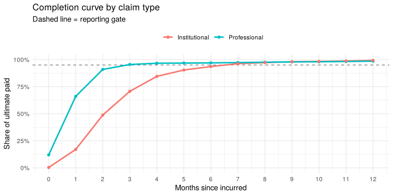

Claims lag triangle & completion factors — walkthrough
================

``` r
library(dplyr)
library(ggplot2)
source("R/pipeline.R")
source_lib(".")

cfg <- load_config(basename(params$config))
res <- run_pipeline(cfg)
```

Valuation date: **2026-06-30**. Factors use the most recent **12**
incurred months at each lag; months are reportable at **95%**
completion.

## 1. Intake: what the feed sent vs what we can use

``` r
res$intake
```

    #> # A tibble: 4 x 2
    #>   stage         rows
    #>   <chr>        <int>
    #> 1 raw_rows      9875
    #> 2 after_dedupe  9835
    #> 3 exceptions      20
    #> 4 clean_rows    9815

``` r
count(res$exceptions, reason_code)
```

    #> # A tibble: 2 x 2
    #>   reason_code              n
    #>   <chr>                <int>
    #> 1 MISSING_SERVICE_DATE     8
    #> 2 PAID_BEFORE_SERVICE     12

## 2. How fast do claims pay?

Professional claims (837P) settle in about a month; facility claims
(837I) take two to three times longer — so one completion curve for “all
claims” would be wrong for both.

``` r
res$lag_profile |>
  mutate(across(starts_with("pct_"), scales::percent, accuracy = 0.1))
```

    #> # A tibble: 2 x 6
    #>   claim_type    claim_lines median_lag_days p90_lag_days pct_paid_30d pct_paid_90d
    #>   <chr>               <int>           <int>        <dbl> <chr>        <chr>       
    #> 1 Institutional        2395              76          155 4.7%         62.2%       
    #> 2 Professional         6971              34           69 42.2%        95.4%

## 3. Cumulative paid triangle (Institutional, last 8 incurred months, \$000s)

Each row is an incurred month; each column is months since incurred. The
lower-right is empty — those payments haven’t happened yet.

``` r
res$triangle |>
  filter(claim_type == "Institutional", incurred_month >= as.Date("2025-11-01"), lag <= 7) |>
  mutate(cumulative_paid = round(cumulative_paid / 1000, 1)) |>
  triangle_wide() |>
  knitr::kable()
```

| incurred_month | lag_0 | lag_1 | lag_2 | lag_3 | lag_4 | lag_5 | lag_6 | lag_7 |
|:---------------|------:|------:|------:|------:|------:|------:|------:|------:|
| 2025-11-01     |   0.0 |  48.6 | 149.0 | 191.3 | 221.4 | 232.4 | 239.4 | 239.4 |
| 2025-12-01     |   0.0 |  53.4 | 139.0 | 199.1 | 234.1 | 257.9 | 266.0 |    NA |
| 2026-01-01     |   0.0 |  54.3 | 157.9 | 217.3 | 267.9 | 291.9 |    NA |    NA |
| 2026-02-01     |   2.4 |  26.5 | 118.4 | 185.0 | 222.9 |    NA |    NA |    NA |
| 2026-03-01     |   0.0 |  42.1 | 132.2 | 178.4 |    NA |    NA |    NA |    NA |
| 2026-04-01     |   0.0 |  19.2 |  78.4 |    NA |    NA |    NA |    NA |    NA |
| 2026-05-01     |   0.0 |  24.3 |    NA |    NA |    NA |    NA |    NA |    NA |
| 2026-06-01     |   0.0 |    NA |    NA |    NA |    NA |    NA |    NA |    NA |

## 4. Completion factors

``` r
res$factors |>
  filter(lag <= 12) |>
  ggplot(aes(lag, completion_factor, colour = claim_type)) +
  geom_hline(yintercept = cfg$completeness_threshold, linetype = "dashed", colour = "grey50") +
  geom_line(linewidth = 1) +
  geom_point() +
  scale_y_continuous(labels = scales::percent, limits = c(0, 1)) +
  scale_x_continuous(breaks = 0:12) +
  labs(x = "Months since incurred", y = "Share of ultimate paid",
       colour = NULL, title = "Completion curve by claim type",
       subtitle = "Dashed line = reporting gate") +
  theme_minimal() +
  theme(legend.position = "top")
```



``` r
res$factors |>
  filter(completion_factor >= cfg$completeness_threshold) |>
  group_by(claim_type) |>
  summarise(first_reportable_lag = min(lag))
```

    #> # A tibble: 2 x 2
    #>   claim_type    first_reportable_lag
    #>   <chr>                        <dbl>
    #> 1 Institutional                    7
    #> 2 Professional                     3

## 5. IBNR for the open months

``` r
res$projection |>
  filter(incurred_month >= as.Date("2026-01-01")) |>
  mutate(across(c(paid_to_date, est_ultimate, ibnr), round),
         completion_factor = round(completion_factor, 3)) |>
  knitr::kable()
```

| claim_type    | incurred_month | current_lag | paid_to_date | completion_factor | method               | est_ultimate |   ibnr | reportable |
|:--------------|:---------------|------------:|-------------:|------------------:|:---------------------|-------------:|-------:|:-----------|
| Professional  | 2026-01-01     |           5 |        47664 |             0.968 | chain_ladder         |        49237 |   1573 | TRUE       |
| Professional  | 2026-02-01     |           4 |        50038 |             0.966 | chain_ladder         |        51785 |   1747 | TRUE       |
| Professional  | 2026-03-01     |           3 |        43408 |             0.955 | chain_ladder         |        45465 |   2058 | TRUE       |
| Professional  | 2026-04-01     |           2 |        42309 |             0.909 | chain_ladder         |        46527 |   4218 | FALSE      |
| Professional  | 2026-05-01     |           1 |        27008 |             0.661 | chain_ladder         |        40870 |  13862 | FALSE      |
| Professional  | 2026-06-01     |           0 |         4126 |             0.120 | bornhuetter_ferguson |        46712 |  42586 | FALSE      |
| Institutional | 2026-01-01     |           5 |       291900 |             0.904 | chain_ladder         |       322927 |  31028 | FALSE      |
| Institutional | 2026-02-01     |           4 |       222865 |             0.845 | chain_ladder         |       263703 |  40838 | FALSE      |
| Institutional | 2026-03-01     |           3 |       178390 |             0.707 | chain_ladder         |       252272 |  73881 | FALSE      |
| Institutional | 2026-04-01     |           2 |        78401 |             0.488 | bornhuetter_ferguson |       199159 | 120758 | FALSE      |
| Institutional | 2026-05-01     |           1 |        24336 |             0.171 | bornhuetter_ferguson |       219920 | 195584 | FALSE      |
| Institutional | 2026-06-01     |           0 |            0 |             0.004 | bornhuetter_ferguson |       234971 | 234971 | FALSE      |

Total IBNR at the valuation date: **\$822,569** on **\$7,909,251** paid
to date.

## 6. Did it work? Backtest against the synthetic truth

The generator knows the full run-out, so we can check the estimate.
Error is `estimate / true ultimate − 1`.

``` r
bt <- backtest(res$projection, cfg$paths$truth, cfg$segment_by)

bt |>
  mutate(maturity = case_when(current_lag <= 2 ~ "0-2 months",
                              current_lag <= 5 ~ "3-5 months",
                              TRUE             ~ "6+ months")) |>
  group_by(claim_type, maturity) |>
  summarise(months = n(),
            mean_abs_err_paid_only = scales::percent(mean(abs(pct_error_paid_only)), 0.1),
            mean_abs_err_projected = scales::percent(mean(abs(pct_error_projected)), 0.1),
            .groups = "drop") |>
  knitr::kable()
```

| claim_type    | maturity   | months | mean_abs_err_paid_only | mean_abs_err_projected |
|:--------------|:-----------|-------:|:-----------------------|:-----------------------|
| Institutional | 0-2 months |      3 | 83.3%                  | 22.1%                  |
| Institutional | 3-5 months |      3 | 21.2%                  | 6.2%                   |
| Institutional | 6+ months  |     24 | 1.4%                   | 0.8%                   |
| Professional  | 0-2 months |      3 | 46.2%                  | 10.0%                  |
| Professional  | 3-5 months |      3 | 5.7%                   | 2.4%                   |
| Professional  | 6+ months  |     24 | 0.6%                   | 0.3%                   |

Takeaways:

- Reporting raw paid-to-date for the last quarter understates cost
  badly, especially for facility claims.
- Chain ladder is accurate once a month has some run-out; for the newest
  months the Bornhuetter-Ferguson fallback keeps the estimate in a sane
  range instead of multiplying a few dollars by a very large factor.
- The reporting gate tells downstream jobs (PMPM dashboards, HEDIS admin
  refreshes) which incurred months are safe to publish.
